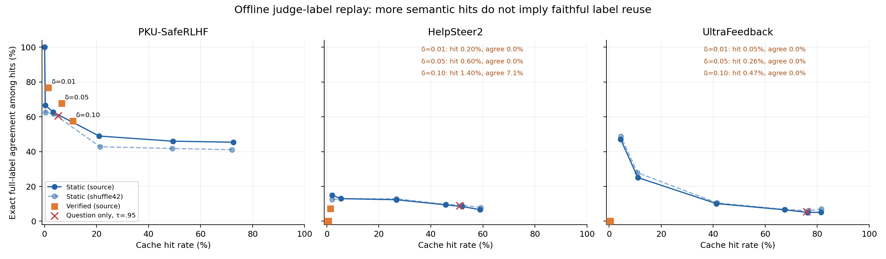

# vCache：三套后训练 judge workload 的命中率实验

本轮已完成 **63 个配置**，每个配置从空缓存开始，使用官方 vCache 的静态策略及 Verified 动态策略。它是一次公开评分标签的离线重放 pilot；衡量可以省下多少次 oracle 查询以及复用标签是否相同，未调用新的 LLM judge、未运行训练，也未测训练加速比。

## 数据集与判定任务

- **PKU-SafeRLHF**：双回答 helpfulness / harmlessness 偏好比较，输出两个 0/1 候选编号；2,000 请求。
- **HelpSteer2**：单回答 helpfulness、correctness、coherence、complexity、verbosity 五维 0–4 评分；2,000 请求。
- **UltraFeedback**：GPT-4 的 instruction_following、truthfulness、honesty、helpfulness 四维 1–5 评分；从 500 指令的 2,000 候选中，统一排除 83 条含缺失 honesty 的记录，所有策略使用相同 **1,917** 请求。保留原始 trace，不补分数；一个原始空回答保留。

PKU 和 HelpSteer2 的 oracle 为人工标签，可构造后训练 judge 的典型输入；UltraFeedback 的 oracle 来自 GPT-4。不能将三套都称为已采集的真实 LLM judge 调用日志。rubric 为固定的简化规范，未复原原始 annotation/API prompt；自由文本 critique 不属于本轮被缓存的输出。

抽样在整个 train split 等距取 100 行的页，非 IID。UltraFeedback 覆盖五类来源，各 100 指令。详细来源、索引、缺失项、许可证及快照哈希见 [dataset_selection.md](dataset_selection.md) 与 [trace_metadata.json](trace_metadata.json)。抽样可影响数值，不能当作生产流量命中率估计。

## 主结果：完整请求，原始顺序

命中标签一致率要求 **全部维度同时相同**，无缺失值参与训练或评估。错误命中占全部请求 = 错误复用次数 / 全部请求；命中标签一致率 = 正确复用次数 / 命中次数。二者分母不同。零命中时一致率记为“—”。

| 数据集 | 策略 | 命中/请求 | 命中率 | 命中标签一致率 | 错误命中数（占全部请求） |
| --- | --- | --- | --- | --- | --- |
| PKU-SafeRLHF | Exact hash | 0/2000 | 0.00% | — | 0 (0.00%) |
| PKU-SafeRLHF | Static τ=0.95 | 67/2000 | 3.35% | 62.69% | 25 (1.25%) |
| PKU-SafeRLHF | Static τ=0.98 | 6/2000 | 0.30% | 66.67% | 2 (0.10%) |
| PKU-SafeRLHF | Verified δ=0.01 | 30/2000 | 1.50% | 76.67% | 7 (0.35%) |
| PKU-SafeRLHF | Verified δ=0.05 | 133/2000 | 6.65% | 67.67% | 43 (2.15%) |
| PKU-SafeRLHF | Verified δ=0.10 | 219/2000 | 10.95% | 57.53% | 93 (4.65%) |
| HelpSteer2 | Exact hash | 0/2000 | 0.00% | — | 0 (0.00%) |
| HelpSteer2 | Static τ=0.95 | 534/2000 | 26.70% | 12.36% | 468 (23.40%) |
| HelpSteer2 | Static τ=0.95 | 534/2000 | 26.70% | 12.36% | 468 (23.40%) |
| HelpSteer2 | Static τ=0.98 | 108/2000 | 5.40% | 12.96% | 94 (4.70%) |
| HelpSteer2 | Verified δ=0.01 | 4/2000 | 0.20% | 0.00% | 4 (0.20%) |
| HelpSteer2 | Verified δ=0.05 | 12/2000 | 0.60% | 0.00% | 12 (0.60%) |
| HelpSteer2 | Verified δ=0.10 | 28/2000 | 1.40% | 7.14% | 26 (1.30%) |
| UltraFeedback | Exact hash | 2/1917 | 0.10% | 100.00% | 0 (0.00%) |
| UltraFeedback | Static τ=0.95 | 790/1917 | 41.21% | 10.13% | 710 (37.04%) |
| UltraFeedback | Static τ=0.98 | 211/1917 | 11.01% | 25.12% | 158 (8.24%) |
| UltraFeedback | Verified δ=0.01 | 1/1917 | 0.05% | 0.00% | 1 (0.05%) |
| UltraFeedback | Verified δ=0.05 | 5/1917 | 0.26% | 0.00% | 5 (0.26%) |
| UltraFeedback | Verified δ=0.10 | 9/1917 | 0.47% | 0.00% | 9 (0.47%) |

静态 τ=0.95 是预设展示点，未据结果调参；全部阈值结果如下。Verified 的 δ 是误差控制参数，不是余弦阈值。[官方 benchmark](https://github.com/vcache-project/vCache/blob/50694eebf0c870231030f73707cb6543d47f0411/benchmarks/_plotter_helper.py#L287-L308) 采用“错误命中数 / 全部请求”口径，不能直接把 δ 解读为命中集合上的错误率上限。例如 PKU δ=.01 的错误命中为 7/2,000=0.35%，命中内错误为 7/30=23.33%；分母不同。本报告不据短流的实测结果宣称理论保证成立或被推翻。



## 静态阈值与请求顺序

每格为“命中率 / 命中标签一致率”。shuffle42 对相同请求做固定种子随机重排；两种顺序各自从空缓存开始，不合并结果。

| 数据集 | 余弦阈值 τ | source | shuffle42 |
| --- | --- | --- | --- |
| PKU-SafeRLHF | 0.80 | 72.60% / 45.39% | 72.05% / 41.08% |
| PKU-SafeRLHF | 0.85 | 49.35% / 46.00% | 49.15% / 41.81% |
| PKU-SafeRLHF | 0.90 | 21.05% / 48.93% | 21.40% / 42.76% |
| PKU-SafeRLHF | 0.95 | 3.35% / 62.69% | 3.40% / 61.76% |
| PKU-SafeRLHF | 0.98 | 0.30% / 66.67% | 0.40% / 62.50% |
| PKU-SafeRLHF | 0.99 | 0.05% / 100.00% | 0.05% / 100.00% |
| HelpSteer2 | 0.80 | 58.90% / 6.62% | 59.15% / 7.86% |
| HelpSteer2 | 0.85 | 52.00% / 8.46% | 51.90% / 9.25% |
| HelpSteer2 | 0.90 | 45.65% / 9.42% | 45.80% / 9.61% |
| HelpSteer2 | 0.95 | 26.70% / 12.36% | 26.80% / 12.87% |
| HelpSteer2 | 0.98 | 5.40% / 12.96% | 5.40% / 12.96% |
| HelpSteer2 | 0.99 | 2.00% / 15.00% | 2.00% / 12.50% |
| UltraFeedback | 0.80 | 81.48% / 5.12% | 81.64% / 7.09% |
| UltraFeedback | 0.85 | 76.26% / 5.06% | 76.58% / 6.06% |
| UltraFeedback | 0.90 | 67.40% / 6.58% | 67.61% / 6.71% |
| UltraFeedback | 0.95 | 41.21% / 10.13% | 41.47% / 10.57% |
| UltraFeedback | 0.98 | 11.01% / 25.12% | 10.85% / 27.88% |
| UltraFeedback | 0.99 | 4.43% / 47.06% | 4.49% / 48.84% |

## Verified：请求顺序与冷启动

| 数据集 | δ | source 命中率 / 一致率 | shuffle42 命中率 / 一致率 | source 有≥4条真实反馈的条目/缓存条目 |
| --- | --- | --- | --- | --- |
| PKU-SafeRLHF | 0.01 | 1.50% / 76.67% | 1.50% / 76.67% | 168/1187 |
| PKU-SafeRLHF | 0.05 | 6.65% / 67.67% | 5.25% / 63.81% | 174/1127 |
| PKU-SafeRLHF | 0.10 | 10.95% / 57.53% | 8.00% / 55.00% | 160/1086 |
| HelpSteer2 | 0.01 | 0.20% / 0.00% | 0.50% / 0.00% | 88/1870 |
| HelpSteer2 | 0.05 | 0.60% / 0.00% | 1.20% / 4.17% | 88/1864 |
| HelpSteer2 | 0.10 | 1.40% / 7.14% | 2.20% / 6.82% | 88/1848 |
| UltraFeedback | 0.01 | 0.05% / 0.00% | 0.42% / 12.50% | 71/1775 |
| UltraFeedback | 0.05 | 0.26% / 0.00% | 1.15% / 4.55% | 72/1771 |
| UltraFeedback | 0.10 | 0.47% / 0.00% | 1.98% / 5.26% | 72/1769 |

官方实现每条目有两条初始伪观测，累计至少四条真实反馈后才进入参数估计和动态决策。2,000 级别的流中大量条目仍未成熟，因此低命中率同时反映请求稀疏性与冷启动；不能外推为长期稳态。反馈在每次请求后立即串行完成，未模拟线上异步反馈延迟。

## 负对照：只嵌入指令

此处仍传完整 prompt 给 vCache，但检索向量只由 instruction 计算；静态 τ=0.95，source 顺序。它刻意忽略候选答案与上下文，不能用于实际 judge 缓存。

| 数据集 | 命中率 | 命中标签一致率 | 同指令不同回答的命中/全部命中 | 错误命中占全部请求 |
| --- | --- | --- | --- | --- |
| PKU-SafeRLHF | 5.20% | 60.58% | 70/104 | 2.05% |
| HelpSteer2 | 51.10% | 8.90% | 978/1022 | 46.55% |
| UltraFeedback | 75.90% | 5.57% | 1320/1455 | 71.67% |

命中率升高本身不能证明缓存有效。同题的候选答案会改变质量评分或成对胜者；缓存判定必须包含答案，成对任务还必须保留候选顺序。具体分组结果见 [hit_group_diagnostics.csv](hit_group_diagnostics.csv)，个例见 [error_analysis.md](error_analysis.md)。

## 标签分布与逐维误差

| 数据集 | 评估请求 | 不同指令 | 不同完整输入 | 众数全标签占比 | 独立随机抽取两标签的一致率 |
| --- | --- | --- | --- | --- | --- |
| PKU-SafeRLHF | 2000 | 1929 | 2000 | 56.25% | 38.55% |
| HelpSteer2 | 2000 | 1000 | 2000 | 16.55% | 4.48% |
| UltraFeedback | 1917 | 494 | 1915 | 11.68% | 3.87% |

上述分布仅是解释指标难度的参照，未作为缓存策略。PKU 比较的是候选编号；不同题的编号同为 0，并不表示答案或推理语义相同。多维严格相等比单维指标更苛刻；逐维一致率和 MAE 帮助区分小分差与严重误复用，不能据“严格相等较低”就断定所有差异同样有害。

| 数据集 | 策略/参数 | 维度 | 命中逐维一致率 | 命中 MAE |
| --- | --- | --- | --- | --- |
| PKU-SafeRLHF | static 0.95 | better_response_id | 70.15% | 0.299 |
| PKU-SafeRLHF | static 0.95 | safer_response_id | 77.61% | 0.224 |
| PKU-SafeRLHF | verified 0.01 | better_response_id | 80.00% | 0.200 |
| PKU-SafeRLHF | verified 0.01 | safer_response_id | 83.33% | 0.167 |
| HelpSteer2 | static 0.95 | coherence | 61.99% | 0.464 |
| HelpSteer2 | static 0.95 | complexity | 76.22% | 0.253 |
| HelpSteer2 | static 0.95 | correctness | 38.20% | 1.092 |
| HelpSteer2 | static 0.95 | helpfulness | 32.96% | 1.159 |
| HelpSteer2 | static 0.95 | verbosity | 54.87% | 0.575 |
| HelpSteer2 | verified 0.01 | coherence | 75.00% | 0.250 |
| HelpSteer2 | verified 0.01 | complexity | 50.00% | 0.500 |
| HelpSteer2 | verified 0.01 | correctness | 50.00% | 0.500 |
| HelpSteer2 | verified 0.01 | helpfulness | 50.00% | 0.750 |
| HelpSteer2 | verified 0.01 | verbosity | 0.00% | 1.000 |
| UltraFeedback | static 0.95 | helpfulness | 30.89% | 0.984 |
| UltraFeedback | static 0.95 | honesty | 39.87% | 1.139 |
| UltraFeedback | static 0.95 | instruction_following | 32.66% | 1.148 |
| UltraFeedback | static 0.95 | truthfulness | 54.68% | 0.863 |
| UltraFeedback | verified 0.01 | helpfulness | 0.00% | 1.000 |
| UltraFeedback | verified 0.01 | honesty | 0.00% | 1.000 |
| UltraFeedback | verified 0.01 | instruction_following | 0.00% | 1.000 |
| UltraFeedback | verified 0.01 | truthfulness | 0.00% | 2.000 |

PKU 的 MAE 是 0/1 编号差，HelpSteer2、UltraFeedback 为各自原始评分尺度；不把跨数据集 MAE 当作可直接比较的奖励损失。

## 实现与复现

- 仓库：[vcache-project/vCache](https://github.com/vcache-project/vCache)，commit `50694eebf0c870231030f73707cb6543d47f0411`。调用真实 `VCache.infer_with_cache_info`、`BenchmarkStaticDecisionPolicy`、`VerifiedDecisionPolicy`、HNSW 与 `NoEvictionPolicy`，未改决策算法。Windows 可选依赖导入兼容修改见 [vcache_compat.patch](vcache_compat.patch)。
- 输入为 canonical JSON：`rubric + context + instruction + ordered candidates`，不含 oracle、rating、critique 或 rationale。UltraFeedback 保留每个回答自己的生成 system prompt。
- embedding 为固定 revision 的 `BAAI/bge-small-en-v1.5`，384 维；每 480 个内容 token 一块，逐块 CLS 向量归一化、按 token 数加权均值后再归一化。没有截掉长回答；这是本实验的自定义 embedding 适配，不等同于 vCache 的默认 OpenAI embedding，也不等同于论文原始设置。
- 使用预计算向量注入 `BenchmarkEmbeddingEngine`、公开完整标签注入 `BenchmarkInferenceEngine`；无新模型推理成本。静态策略只在 miss 加入缓存；Verified 在探索后使用完整标签相等反馈。每请求等待 future 与 callback 更新完毕，避免预计算向量被下一条请求覆盖。
- 缓存容量 N+10、无淘汰；原始顺序与 seed=42 重排；静态阈值 .80/.85/.90/.95/.98/.99，Verified δ=.01/.05/.10。仅一个 seed，没有总体置信区间或统计显著性结论。
- 所有配置相同缺失过滤规则；签名绑定 trace、embedding、脚本、代码 diff 和配置，防止 resume 混入旧结果。完整软件版本及签名在 [run_manifest.json](run_manifest.json)。
- 本机为 Windows / Python 3.12 / RTX 4060 Laptop（8 GB），使用已有安装环境；部分版本超出仓库声明的依赖范围，不能称为官方锁定环境复现。实际依赖版本见 [requirements-observed.txt](requirements-observed.txt)，模型权重 SHA256 与硬件在 [environment_snapshot.json](environment_snapshot.json)。
- 分析脚本独立复核 57 份事件文件的全部 112,423 条记录，逐条核对请求索引、原始索引、oracle 与命中来源标签，汇总计数与事件一致；检查记录见 [protocol_audit.md](protocol_audit.md)。

原始 2,000 条/库的输入长度（BGE tokenizer，未过滤缺失行）：

| 数据集 | 中位 token | P95 token | 最大 token | 超过510 token的请求 |
| --- | --- | --- | --- | --- |
| PKU-SafeRLHF | 313.5 | 467.0 | 1542 | 51 |
| HelpSteer2 | 521.0 | 1188.0 | 2965 | 1034 |
| UltraFeedback | 519.5 | 1188.05 | 2607 | 1022 |

```powershell
# 在本任务目录执行；work/vCache 是上述 commit，先应用兼容补丁并安装依赖
python outputs/prepare_judge_traces.py --sampling spread
python outputs/run_judge_vcache_benchmark.py --stage embed
python outputs/run_judge_vcache_benchmark.py --stage benchmark --no-resume
python outputs/analyze_judge_vcache_results.py
```

原始请求和 raw 页、来源元数据打包在 [judge_trace_snapshot.zip](judge_trace_snapshot.zip)，便于无需再次下载 HF 数据而精确复现；解压目录中的 `data/` 放回 `work/data/`。原始数据的各自许可证仍适用。已有完整 embedding 不必重算；第二次 benchmark 可默认 resume，但输入签名变化时会拒绝混跑。

## 对后训练缓存适配的含义

1. 将 judge model 版本、rubric 版本、system context、完整回答与候选顺序作为缓存命名空间与输入契约；只有题目相似不足以复用奖励。
2. 用候选敏感的检索与验证：指令、上下文、回答分别编码，避免长题目或模板稀释短答案差异；涉及数值、否定、关键事实或成对顺序变化时优先回退真实 judge。是否优于当前整体向量需另做受控实验。
3. 根据训练目标定义可接受误差，例如偏好翻转率、每维 MAE、奖励偏差及排序保持率；在独立校准流上选择阈值，再报告在质量约束下的命中率，不能在同一评估流上挑最佳阈值。
4. 下一轮使用真实训练 rollout 顺序：同一指令的多候选、重复 epoch 和策略版本变化，以及真实 judge 延迟/费用。分别评估精确缓存与语义增益、训练奖励漂移及端到端吞吐。当前重放时间只表示本地策略执行耗时，不能称为训练加速比。

本轮结果支持把该方向继续拆成“候选敏感的安全复用”和“满足奖励保真约束时能获得多少命中”；这些实验尚未证明通用语义缓存能直接加速后训练。
